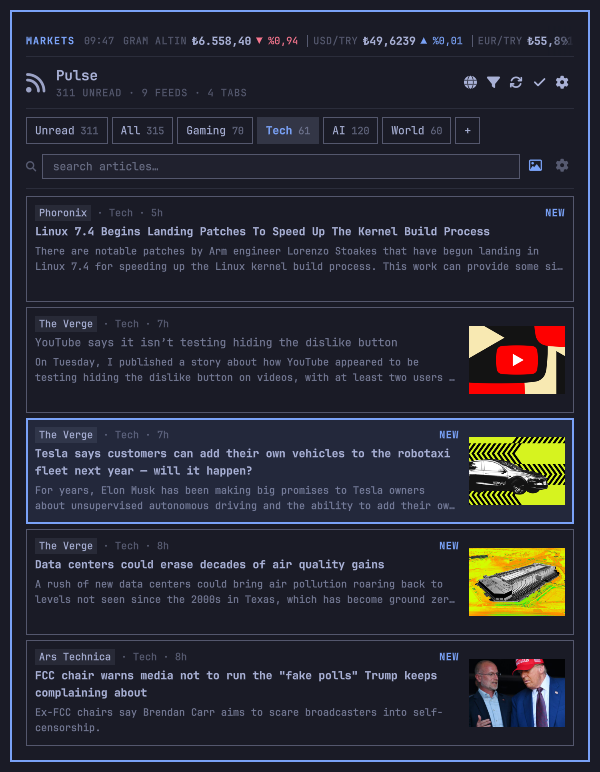
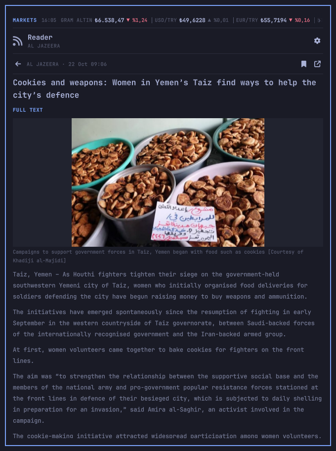

# Gazette

**A local-first RSS/Atom reader with a live markets ticker, custom tabs and article thumbnails — built for [Omarchy](https://omarchy.org/).**

Gazette lives in the Omarchy bar. Click the RSS icon (or press `Super+Ctrl+W` if you bind it) and a keyboard-driven panel opens with four markets pinned at the top, your own news tabs, thumbnails from the feeds, and an in-panel reader.





Tested on **Omarchy 4.0.6** with **Quickshell 0.3.2** and **Rust 1.99**.

---

## What it does

### Markets above everything
- Pinned ticker strip at the top of the panel: label, price, daily change, stale marker.
- Optional compact ticker in the bar (choose which symbol it shows).
  **Off by default** — the bar is just the RSS icon unless you enable it in Markets.
- Defaults: **gram altın, USD/TRY, EUR/TRY, BIST 100**. Enable more from the presets or add any Yahoo symbol.
- **No API keys.** Yahoo Finance is the primary source; TCMB and open.er-api.com are fallbacks for USD/TRY. Metals are converted locally:
  - gram altın = `XAU/USD × USD/TRY ÷ 31.1034768`
  - çeyrek altın = gram × 1.6 (24k-equivalent estimate; shown as an estimate, not a jeweller quote)
- 60-second refresh while the panel is open, 5-minute background refresh for the bar. Last-known values stay visible (dimmed) when the network is down.
- Turkish number formatting: `₺6.542,18`, `▼ %1,08`.

### Tabs that are actually yours
- Built-in `Unread`, `All` and `Saved` views, then any tabs you create: Gaming, Tech, AI, World, Linux, Space — whatever.
- Each tab has a name, optional glyph, ordered feed list, include/exclude keywords and its own notification switch.
- A tab with no feeds becomes a keyword-only tab across every subscription.
- Per-tab unread counts, mark-tab-read, reorder, rename, delete.
- Feeds can belong to several tabs.

### Pictures in the news
- Thumbnails extracted from `media:thumbnail`, `media:content`, `enclosure`, Atom enclosures and the first `` in the article body.
- If a feed ships no image at all (Al Jazeera, Phoronix, Hugging Face…), Gazette reads the article page's `og:image` / `twitter:image` for the newest items.
- Images are downloaded to a local cache, MIME-sniffed, capped at 3 MB each, and evicted LRU-style at 200 MB. No SVG, no tracking pixels, no `data:` URLs.
- Thumbnails in the list, a large hero image in the reader, global on/off switch.

### The rest
- Full-text search across headlines, summaries and feed names.
- In-panel reader with the article body converted to **plain text** (no remote markup is rendered).
- Bookmarks, read/unread, mark-all-read, feed enable/disable and health errors.
- Desktop notification summaries for new unread articles, with minimum interval and quiet hours.
- OPML import/export; paste a site homepage and Gazette discovers its feed.
- Keyboard-first: `j/k`, arrows, `Enter`, `o`, `b`, `/`, `r`, `Esc`.
- Follows the active Omarchy theme automatically via `qs.Commons` (`Color`, `Style`, `BorderSurface`, `KeyboardPanel`).
- One small Rust binary. No telemetry, no accounts, no daemon, no database.

---

## Install

Requirements: Omarchy (Quickshell), a Rust toolchain (`cargo`), `notify-send` for notifications.

```bash
# 1. Add the plugin (clones into ~/.config/omarchy/plugins/io.github.kaplanhalil.gazette)
omarchy plugin add https://github.com/KaplanHalil/omarchy-gazette.git --enable

# 2. Build the engine once
cd ~/.config/omarchy/plugins/io.github.kaplanhalil.gazette
./install.sh

# 3. Reload the shell
omarchy restart shell
```

If the widget does not appear, place it explicitly:

```bash
omarchy plugin enable io.github.kaplanhalil.gazette right
# or add {"id":"io.github.kaplanhalil.gazette"} to bar.layout.right in
# ~/.config/omarchy/shell.json (hot-reloads on save)
```

### Manual / development install

```bash
git clone https://github.com/KaplanHalil/omarchy-gazette.git \
  ~/.config/omarchy/plugins/io.github.kaplanhalil.gazette
cd ~/.config/omarchy/plugins/io.github.kaplanhalil.gazette
./install.sh
omarchy plugin enable io.github.kaplanhalil.gazette right
omarchy restart shell
```

`install.sh` builds `gazette-engine` and installs it to `~/.local/bin`. To keep the binary somewhere else:

```bash
GAZETTE_BIN_DIR=~/.cargo/bin ./install.sh
# and tell the panel where it is:
GAZETTE_ENGINE=/path/to/gazette-engine
```

`install.sh` is safe to re-run after `omarchy plugin update`.

### First run

Gazette starts with no subscriptions. Open the panel and press `f`, then either paste a feed URL or click **ADD STARTER PACK** for nine feeds across Gaming, Tech, AI and World. Tabs are created with the pack; edit or delete them at any time.

### Uninstall

```bash
omarchy plugin remove io.github.kaplanhalil.gazette
rm -f ~/.local/bin/gazette-engine
rm -rf ~/.local/state/omarchy/gazette ~/.cache/omarchy/gazette
```

---

## Using it

### Keyboard

| Key | Action |
| --- | --- |
| `j` / `k`, `↓` / `↑` | Move the article cursor |
| `h` / `l`, `←` / `→`, `Tab` / `Shift+Tab` | Previous / next tab |
| `Enter` | Open the reader |
| `o` | Open in browser |
| `b` or `x` | Bookmark / unbookmark |
| `/` | Search |
| `a` | Mark the current tab read |
| `r` | Refresh feeds and prices |
| `g` | Jump to the top |
| `f` / `t` / `m` / `s` | Feeds / Tabs / Markets / Settings |
| `n` | New tab (Tabs view), focus URL (Feeds), custom ticker (Markets) |
| `Esc` | Back, clear search, or close |

The reader marks an article read when you open it; use **MARK UNREAD** if you want it back in the queue.

Bind a global shortcut via Hyprland:

```lua
o.bind("SUPER + CTRL + W", "Gazette", "omarchy-shell io.github.kaplanhalil.gazette toggle")
```

### Market presets

Open **Markets**. The presets cover gram/çeyrek/ons gold, gram silver, USD/TRY, EUR/TRY, GBP/TRY, EUR/USD, BTC/TRY, ETH/TRY, BIST 100, NASDAQ and S&P 500. Custom entries take any Yahoo symbol (`XAUUSD=X`, `^IXIC`, `BTC-USD`, …) and a display currency. Prices are shown in TRY unless the ticker is quoted in USD.

### Notifications

One summary notification per refresh, at most every *N* minutes (default 30), outside quiet hours (default 23:00–08:00). Per-tab switches in the tab editor decide which categories can notify; articles in no tab follow the global switch.

---

## CLI

The panel is a thin UI over `gazette-engine`. Everything is scriptable:

```bash
gazette-engine --snapshot                 # full JSON used by the UI
gazette-engine --refresh                  # fetch all enabled feeds
gazette-engine --markets                  # refresh quotes
gazette-engine --status [--json]
gazette-engine --mark-read <id>
gazette-engine --mark-unread <id>
gazette-engine --mark-all-read [--tab <id>]
gazette-engine --bookmark <id> <0|1>
gazette-engine --image <article-id>
gazette-engine --add-feed <url> [--title <name>] [--tabs a,b]
gazette-engine --remove-feed <id>
gazette-engine --toggle-feed <id>
gazette-engine --save-tab '<json>'
gazette-engine --delete-tab <id>
gazette-engine --move-tab <id> <up|down>
gazette-engine --save-settings '<json>'
gazette-engine --save-markets '<json>'
gazette-engine --import-opml <path>
gazette-engine --export-opml [path]
gazette-engine --seed-starter
gazette-engine --ack-notifications
gazette-engine --clean
```

All commands print JSON (`{"ok":true,…}` or `{"ok":false,"error":"…"}`) except `--status`, `--help` and `--version`. A lock prevents the timer and a manual refresh from writing state at the same time.

---

## Configuration

| What | Where |
| --- | --- |
| Feeds, tabs, tickers, settings | `~/.local/state/omarchy/gazette/config.json` |
| Articles, read flags, quote cache | `~/.local/state/omarchy/gazette/state.json` |
| Images | `~/.cache/omarchy/gazette/images/` |
| Engine binary | `~/.local/bin/gazette-engine` |

Both files are written atomically with mode `0600`; the directories are `0700`. The panel never renders feed HTML — the engine strips it to plain text.

A tab in `config.json`:

```json
{
  "id": "ai",
  "name": "AI",
  "glyph": "\uf085",
  "feeds": ["huggingfaceco-61d3", "deepmindgoogle-9c92"],
  "include": ["model", "llm", "inference"],
  "exclude": ["sponsored"],
  "notify": true,
  "images": null
}
```

`include` is applied *inside* the tab: when non-empty, an article must match at least one keyword. With no feeds, the tab becomes keyword-only across all subscriptions. `exclude` always wins.

---

## Security & privacy

- State stays on the machine. No analytics, no accounts, no cloud service.
- Feed and article HTML is reduced to plain text before it reaches QML; every dynamic `Text` uses `Text.PlainText`.
- HTTP(S) only, hard byte caps (6 MB feeds, 3 MB images, 768 KB for `og:image` pages), connect/read timeouts, no `data:` or `file:` fetches.
- Images are identified by magic bytes, not by the server's `Content-Type`, and SVG is rejected.
- Symlinked state/cache paths are refused; temp files are renamed into place.
- `notify-send` is the only external process besides `gazette-engine`, and it is only used for the summary you enabled.

Third-party endpoints: Yahoo Finance, TCMB, open.er-api.com, plus your own feeds and (optionally) their article pages for `og:image`. Yahoo's chart endpoint is undocumented and can change; quotes fall back to the last cached value and are marked stale.

---

## Troubleshooting

**The bar shows nothing / “Engine: … not found”** — build the engine: `cd ~/.config/omarchy/plugins/io.github.kaplanhalil.gazette && ./install.sh`. Check `~/.local/bin/gazette-engine --status`.

**Some feeds show TLS/connection errors** — a few publishers reset connections from VPNs/datacenters. Gazette keeps the feed and retries on the next refresh. Errors are listed in **Feeds**.

**No images for a feed** — the feed carries none and its article pages block `og:image` scraping. The text still renders.

**“another gazette-engine operation is running”** — a refresh is in flight (or a stale lock is younger than five minutes). Wait for it to finish.

**QML errors after an update** — `omarchy restart shell`, then `journalctl --user -f | grep -i gazette`.

**Reset everything** — quit the shell widget, then `rm -rf ~/.local/state/omarchy/gazette ~/.cache/omarchy/gazette`; Gazette recreates defaults on the next start.

Logs: `journalctl --user -b | grep -i gazette`.

---

## Development

```
Cargo.toml           engine crate
src/                 feeds, markets, images, OPML, state, snapshot
qml/                 panel views and cards
BarWidget.qml        bar icon, unread dot, optional ticker, IPC
Panel.qml            engine queue, view state, keyboard, timers
manifest.json        Omarchy plugin manifest
install.sh           cargo build + install engine
```

```bash
cargo test                 # 21 parser/market/OPML/text tests
cargo build --release
omarchy plugin validate .
```

The engine has no async runtime: a small scoped-thread pool fetches feeds and images, and the UI serialises commands through one queue.

MIT © 2026 Halil Kaplan. Not affiliated with Omarchy or the OmaRSS plugin.
